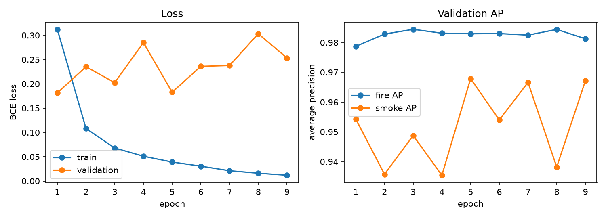

# Vision channel on D-Fire: MaxViT-tiny vs YOLOv8n

Measured on 2026-10-23/24 on an Apple M5 (MPS). Every number below comes from a
file in `models/` or `~/datasets/d-fire/` that the scripts wrote. None is
estimated. **These are D-Fire numbers, not FireSense numbers.** They say how
well each model separates fire and smoke from ordinary outdoor scenes in a
public dataset. They don't say how the camera behaves in the deployment room.
That needs `evaluate_on_frames.py` on `data/vision_check/` (CLAUDE.md rule 10),
and it hasn't been run yet because the frames haven't been captured.

## 1. Dataset

**D-Fire** (Venâncio, Lisboa & Barbosa, *An automatic fire detection system
based on deep convolutional neural networks for low-power, resource-constrained
devices*, Neural Computing and Applications, 2022).

- Source: Hugging Face mirror `hanvithSai/gavin-dfire-raw` (`train.tar`,
  `test.tar`). Both SHA-256 values matched the ones published on Hugging Face
  before extraction. The official OneDrive download kept failing.
- **Licence: CC0 1.0 Universal** (the original D-Fire LICENSE, saved as
  `~/datasets/d-fire/LICENSE_DFire_original.txt`). Its preamble: the images are a
  public-domain collection, and the authors release their collection under CC0.
  The mirror's README says CC BY 4.0. That is the mirror's error, and the
  original licence applies. Citing the paper above is still the right thing to do.
- Labels: YOLO boxes, class 0 = smoke, class 1 = fire. An image's label comes
  from its boxes: fire = any fire box, smoke = any smoke box. "Neither" means no
  boxes.

| split | images | neither | fire only | smoke only | both |
|---|---:|---:|---:|---:|---:|
| official train | 17,221 | 7,833 | 944 | 4,681 | 3,763 |
| → our train part | 14,637 | | | | |
| → our validation part | 2,584 | 1,245 | 99 | 701 | 539 |
| official test | 4,306 | 2,005 | 220 | 1,186 | 895 |

The totals match the authors' published counts.

### Leakage audit (`dfire_audit.py`, results in `~/datasets/d-fire/extracted/audit.json`)

- 0 file names in both train and test, and 0 byte-identical images across the
  splits.
- **2,211 of 4,306 test images (51%) have a near-duplicate in train** (64-bit
  difference hash, ≤ 4 differing bits). By source: AoF 1,541/1,661,
  PublicDataset 145/281, WEB 525/2,364. In a visual check of 8 flagged pairs, 7
  were the same fixed camera at a different moment and 1 was a false match. The
  official split separates file-number blocks, not scenes, so frames from one
  video can land on both sides.
- So I report the test set twice: the **official split** (comparable with the
  literature) and the **2,095 test images with no near-duplicate in train**
  (closer to "a scene the model never saw").
- My validation part is **grouped**, never split at random. Images are chained
  into groups when consecutive file numbers are within 10 hash bits, or when any
  two images are within 4 bits. That gives 8,114 groups, the largest with 1,077
  images. 15% of groups go to validation. This follows the same principle as
  CLAUDE.md rule 3 (split by session, never by window).

## 2. Models and training

Both models use the same train/validation split (`models/maxvit_dfire/split.json`).
Thresholds and the checkpoint were chosen on validation only. The test split was
read exactly once per model, at the end. Both scripts refuse a second test pass.

| | MaxViT-tiny (`train_vision.py`) | YOLOv8n (`train_yolo.py`) |
|---|---|---|
| Starting weights | `maxvit_tiny_tf_224.in1k` (ImageNet, timm 1.0.30) | `yolov8n.pt` (COCO, ultralytics 8.4.163) |
| Task | 2 sigmoid outputs (fire, smoke), BCE | box detection, 2 classes |
| Image score | sigmoid output | most confident box of that class (0 if none) |
| Input | 224×224, whole frame resized | 640 (letterboxed) |
| Batch / optimiser | 32 / AdamW, lr 1e-4, wd 0.05, 1-epoch warm-up + cosine | 16 / ultralytics "auto" (chose MuSGD, lr 0.01) |
| Augmentation | horizontal flip, brightness/contrast 0.8–1.2 | ultralytics defaults (mosaic, HSV, flip, …) |
| Regularisation | drop-path 0.1, early stop patience 4 | early-stop patience 10 |
| Ran | 9 epochs, 121 min (early stop); best = epoch 5 | **6 epochs, 5.0 h** (see below) |
| Thresholds (max F1 on val) | fire 0.36, smoke 0.88 | fire 0.12, smoke 0.14 |

**MaxViT learning curves** (`reports/vision_maxvit_curves.png`):

| epoch | train loss | val loss | val AP fire | val AP smoke | val mAP |
|---:|---:|---:|---:|---:|---:|
| 1 | 0.312 | 0.181 | 0.979 | 0.954 | 0.967 |
| 2 | 0.108 | 0.235 | 0.983 | 0.936 | 0.959 |
| 3 | 0.068 | 0.203 | 0.984 | 0.949 | 0.967 |
| 4 | 0.051 | 0.285 | 0.983 | 0.935 | 0.959 |
| **5** | 0.039 | 0.183 | 0.983 | 0.968 | **0.975** |
| 6 | 0.031 | 0.236 | 0.983 | 0.954 | 0.969 |
| 7 | 0.021 | 0.238 | 0.982 | 0.967 | 0.975 |
| 8 | 0.016 | 0.303 | 0.984 | 0.938 | 0.961 |
| 9 | 0.012 | 0.253 | 0.981 | 0.967 | 0.974 |

Training loss keeps falling while validation loss is lowest at epoch 1 and noisy
afterwards. The model overfits quickly. Selecting on validation AP keeps epoch 5.

**YOLO under-trained.** The run was capped at 2 h (`time=2.0`), but ultralytics
checks the cap only at the end of an epoch. Epochs 1–5 took 8–13 min each, and
epoch 6 took 254 min, for unknown reasons. The Mac did not sleep. Possible causes
are thermal throttling or an MPS stall, but neither was checked. Box mAP50 on
validation was 0.42 and still rising. **The YOLO numbers below are for a
detector after 6 epochs, not a converged one.** Treat the comparison as
"MaxViT vs a lightly fine-tuned YOLOv8n".

## 3. Results

"False alarms on neither" = images with no fire and no smoke where either output
crossed its threshold. For FireSense this is the column that matters (the
nuisance-alarm claim). "Fire output alone" counts only fire calls on those images.
"Hazard detected" = images with fire or smoke where at least one output fired.

### Validation (2,584 images; thresholds were chosen here, so this is optimistic)

| | fire P / R | fire AP | smoke P / R | smoke AP | false alarms on neither | fire output alone | hazard detected |
|---|---|---:|---|---:|---:|---:|---:|
| MaxViT | 0.971 / 0.948 | 0.983 | 0.917 / 0.931 | 0.968 | 72/1,245 = 5.8% | 0.1% | 94.8% |
| YOLOv8n | 0.894 / 0.856 | 0.927 | 0.683 / 0.798 | 0.778 | 413/1,245 = 33.2% | 3.9% | 82.0% |

### Test, official D-Fire split (4,306 images, used once)

| | fire P / R | fire AP | smoke P / R | smoke AP | false alarms on neither | fire output alone | hazard detected |
|---|---|---:|---|---:|---:|---:|---:|
| MaxViT | 0.972 / 0.959 | 0.990 | 0.969 / 0.956 | 0.990 | **28/2,005 = 1.4%** | 0.1% | 97.0% |
| YOLOv8n | 0.898 / 0.871 | 0.944 | 0.746 / 0.748 | 0.820 | 457/2,005 = 22.8% | 3.7% | 78.1% |

### Test, images with no near-duplicate in train (2,095 images, same single pass)

| | fire P / R | fire AP | smoke P / R | smoke AP | false alarms on neither | fire output alone | hazard detected |
|---|---|---:|---|---:|---:|---:|---:|
| MaxViT | 0.962 / 0.953 | 0.988 | 0.967 / 0.967 | 0.987 | **14/755 = 1.9%** | 0.3% | 98.1% |
| YOLOv8n | 0.883 / 0.841 | 0.936 | 0.806 / 0.859 | 0.878 | 234/755 = 31.0% | 7.0% | 88.0% |

### Confusion matrices, official test (rows = true, columns = predicted)

MaxViT:

| true \ predicted | neither | fire only | smoke only | both |
|---|---:|---:|---:|---:|
| neither | 1,977 | 2 | 26 | 0 |
| fire only | 7 | 176 | 5 | 32 |
| smoke only | 60 | 1 | 1,097 | 28 |
| both | 3 | 28 | 31 | 833 |

YOLOv8n:

| true \ predicted | neither | fire only | smoke only | both |
|---|---:|---:|---:|---:|
| neither | 1,548 | 44 | 383 | 30 |
| fire only | 11 | 91 | 11 | 107 |
| smoke only | 476 | 2 | 674 | 34 |
| both | 16 | 30 | 106 | 743 |

Validation confusion for MaxViT, for completeness: neither [1173, 1, 71, 0],
fire only [2, 64, 4, 29], smoke only [61, 0, 623, 17], both [6, 18, 21, 494].

### Reading the numbers

- On D-Fire, MaxViT beats this YOLOv8n on every metric. The biggest gap is
  false alarms on scenes with neither fire nor smoke: 1.4% vs 22.8%. Almost all
  of YOLO's false alarms are smoke calls (413 of its 457 on the official test
  include smoke). I didn't check which scenes trigger them. The YOLO run was cut short (section 2), so this compares against an
  under-trained detector, not against YOLO in general.
- The test numbers are **better** than validation for MaxViT (1.4% vs 5.8% false
  alarms). That is expected here. Validation was grouped by scene, while half
  the official test has near-duplicates in train. Even the no-near-duplicate
  subset (1.9%) beats validation, so validation is the more cautious estimate.
  If anyone asks for one MaxViT number, quote the validation figure too.
- Most of MaxViT's remaining errors are between "fire only" and "both". When a
  fire is visible, it often calls smoke too. For an alarm that doesn't matter,
  because both mean hazard.

## 4. Limitations (state these in the viva)

1. **Outdoor dominance.** D-Fire is mostly outdoor scenes: forest, roadside and
   city-camera footage. FireSense watches an indoor room with an ESP32-CAM
   (OV3660), with different light, white balance, noise and JPEG quality. None
   of these numbers transfer. The deciding test is the separation margin on
   `data/vision_check/{normal,flame}` frames from that camera
   (`python evaluate_on_frames.py --model models/maxvit_dfire/best.pt`).
2. **No cooking in the data.** Steam, pan smoke and a gas-hob flame, the very
   nuisance cases FireSense exists to handle, are essentially absent from D-Fire.
   A 1.4% outdoor false-alarm rate says nothing about bacon.
3. **Video-frame leakage in the official split.** 51% of test images have a
   near-duplicate in train, so the official-split numbers are inflated to an
   unknown degree. The subset without near-duplicates and the grouped validation
   split are the fairer figures. A 4-bit dHash catches near-identical frames but
   not the same scene after a camera move, so some leakage may remain even in
   that subset.
4. **Thresholds come from D-Fire validation**, not from the room. They have to
   be re-chosen on deployment frames before use, as CLAUDE.md says for
   `CONF_THRESHOLD`.
5. **Overfitting.** MaxViT's validation loss was lowest at epoch 1. Selection by
   validation AP is reasonable, but more data or stronger augmentation would
   probably help more than more epochs.
6. **YOLO run incomplete** (6 epochs, see section 2). A longer run would
   probably narrow the gap, but by how much hasn't been measured.
7. **26 train JPEGs were rewritten by ultralytics** ("corrupt JPEG restored").
   21 are in our train part and 5 in our val part, all WEB images, and none in
   test. The originals are still in the checksum-verified `train.tar`. MaxViT's
   cache was built before the rewrite, so the two models saw slightly different
   bytes for those 26 images. The effect on these results is negligible but
   nonzero.
8. **The 224×224 resize squashes 16:9 frames.** It is consistent between
   training, evaluation and `evaluate_on_frames.py`, but small distant flames
   lose detail. YOLO at 640 may do better on small fires. These image-level
   metrics don't separate that out, and it wasn't measured.

## 5. Files

- `dfire_audit.py`: counts, cross-split duplicates, near-duplicate and
  video-frame grouping.
- `train_vision.py`: MaxViT training (`--cache`, default train, `--test` once).
- `train_yolo.py`: YOLOv8n training, image-level validation, `--test` once.
- `evaluate_on_frames.py`: either model on `data/vision_check/{normal,flame}`.
- Outputs (gitignored): `models/maxvit_dfire/{best.pt, history.json, split.json,
  val_results.json, test_results.json, curves.png}`,
  `models/yolo_dfire/{weights/best.pt, results.csv, val_results.json,
  test_results.json}`.
